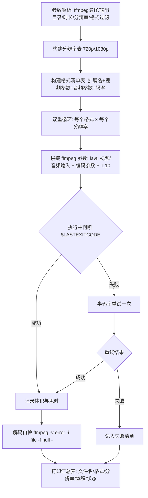

## 产品概述

使用工作区内已有的 ffmpeg 可执行文件，批量生成一套用于播放器/解码兼容性测试的短视频文件，输出到 videos 目录，并提供一个可重复执行、可改参数的生成脚本。

## 核心需求

- 片源：由 ffmpeg lavfi 合成，无外部素材。画面为 testsrc2 彩条+计时器（含移动色块与秒表），音轨为 440Hz 正弦音。
- 时长：每个文件固定 10 秒。
- 分辨率：每种格式生成两版，720p（1280x720）与 1080p（1920x1080）。
- 格式覆盖（15 种容器+编码组合，共 30 个文件）：
MP4/H.264、MP4/HEVC、MKV/H.264、MKV/VP9、WebM/VP9、WebM/VP8、AVI/MPEG-4+MP3、MOV/H.264、MOV/ProRes、TS/H.264、FLV/H.264+MP3、ASF/WMV2+WMA、MPG/MPEG-2+MP2、3GP/MPEG-4+AAC、OGV/Theora+Vorbis。
- 生成方式：在 videos 目录下新建 generate_test_videos.ps1，内含格式清单与分辨率清单，可反复运行；随后执行一次产出全部文件。
- 交付结果：videos 目录下的 30 个测试文件 + 一份文件名/格式/体积/时长清单，并说明哪些组合失败及原因。

## 技术选型

- 平台：Windows + PowerShell（脚本宿主）
- 工具：工作区自带 `tools/ffmpeg.exe`（ffmpeg 2022-10-30 essentials，libavformat 59.34.101，已静态编译 libx264/libx265/libvpx/libvpx-vp9/libtheora/libmp3lame/libvorbis/libopus/libxvid）
- 片源：ffmpeg lavfi 虚拟输入（testsrc2 + sine），无需任何外部素材文件
- 无 ffprobe.exe：校验环节改用 `ffmpeg -v error -i <file> -f null -` 做解码自检，用 `Get-Item` 取体积

## 实现方案

用一份"格式清单数据表"驱动脚本：脚本内定义分辨率数组（720p/1080p）与格式数组（每条含扩展名、视频编码器参数、音频编码器参数、按分辨率区分的码率），双重循环调用 ffmpeg，统一 `-t 10 -pix_fmt yuv420p -ar 44100 -ac 2 -y`，每步检查 `$LASTEXITCODE`，失败自动降码率重试一次，最后打印汇总表。

关键决策与权衡：

- **统一用 lavfi 两个输入**：`-f lavfi -i testsrc2=size=WxH:rate=30:duration=10` 与 `-f lavfi -i sine=frequency=440:duration=10`，配合 `-t 10` 双保险保证正好 10 秒；`-pix_fmt yuv420p` 保证 WMV/3GP/Theora/AVI 等格式的像素格式兼容。
- **3GP 用 MPEG-4 替代 H.263**：H.263 编码器仅支持到 CIF（352x288），无法编码 720p/1080p，故 3GP 组合改用 mpeg4 + aac（同为 3GP 标准支持），脚本注释中显式说明该替换。
- **ProRes 体积控制**：ProRes 为帧内编码，1080p30 10 秒在 profile 2 下可达数百 MB，默认使用 `prores_ks -profile:v 0`（Proxy），并把 profile 作为脚本顶部可调变量。
- **VP8/VP9 编码速度**：加 `-deadline good -cpu-used 4 -row-mt 1`，1080p 10 秒控制在数十秒级，避免脚本整体耗时过长。
- **MPG（MPEG-PS）风险**：mpeg2video + mpeg muxer 在高分辨率/高码率下易报 "buffer underflow / mux rate too high"，故显式给 `-b:v -maxrate -bufsize`，并在失败时以半码率重试。
- **兼容性细节**：MP4/MOV 加 `-movflags +faststart`；MP4 内 HEVC 加 `-tag:v hvc1`；ASF 用 wmv2+wmav2（原生编码器，需 `-b:v` 而非 CRF）；FLV 用 libx264+libmp3lame；TS 用 libx264+aac。

## 实施要点（执行细节）

- 路径：脚本用 `Join-Path $PSScriptRoot '..\tools\ffmpeg.exe'` 定位 ffmpeg，参数化 `-Ffmpeg` / `-OutDir` / `-Duration` / `-Fps` / `-Formats`，便于复用。
- 调用方式：用数组 splatting `& $ffmpeg @args`，避免 PowerShell 参数拆分问题；`-hide_banner -loglevel error -stats` 控制输出噪音。
- 日志与影响面：只写 videos 目录；失败不中断整体流程，收集失败项最后统一打印原因；不改动 tools 目录与 ffmpeg。
- 命名：`test_<720p|1080p>_<容器>_<编码>.<ext>`，例如 `test_720p_mp4_h264.mp4`、`test_1080p_webm_vp9.webm`、`test_1080p_mov_prores.mov`。
- 性能：30 个文件预计总耗时数分钟（VP9/ProRes/HEVC 为瓶颈）；脚本按"格式 × 分辨率"顺序串行执行，避免多进程争抢 CPU。

## 架构设计

单一脚本、数据驱动，无外部依赖：



## 目录结构

```
c:/Users/al_ta/CodeBuddy/video_player/
├── tools/
│   └── ffmpeg.exe                      # [已有] 2022 essentials 构建，含 x264/x265/vpx/vp9/theora/mp3lame/vorbis/opus
└── videos/
    ├── generate_test_videos.ps1        # [NEW] 可复用生成脚本：参数块、分辨率表、格式清单表、循环调用 ffmpeg、失败重试、解码自检、汇总输出
    ├── README.md                       # [NEW] 产出清单说明：文件名↔容器/编码/音频对照表、生成命令、已知注意事项（ProRes 体积、3GP 用 MPEG-4、MPG 码率敏感）
    ├── test_720p_mp4_h264.mp4          # [NEW] 以下 30 个为脚本产出：10 秒、含 440Hz 音轨
    ├── test_1080p_mp4_h264.mp4
    ├── test_*_mp4_hevc.mp4
    ├── test_*_mkv_h264.mkv / test_*_mkv_vp9.mkv
    ├── test_*_webm_vp9.webm / test_*_webm_vp8.webm
    ├── test_*_avi_mpeg4.avi
    ├── test_*_mov_h264.mov / test_*_mov_prores.mov
    ├── test_*_ts_h264.ts
    ├── test_*_flv_h264.flv
    ├── test_*_asf_wmv2.wmv
    ├── test_*_mpg_mpeg2.mpg
    ├── test_*_3gp_mpeg4.3gp
    └── test_*_ogv_theora.ogv
```

## 关键代码结构

```
# 格式清单条目结构（脚本内数组元素，驱动全部生成逻辑）
[pscustomobject]@{
    Name    = 'webm_vp9'          # 文件名片段
    Ext     = 'webm'              # 输出扩展名
    Video   = @('-c:v','libvpx-vp9','-crf','32','-b:v','0',
                '-deadline','good','-cpu-used','4','-row-mt','1')  # 视频编码参数
    Audio   = @('-c:a','libopus','-b:a','96k')                     # 音频编码参数
    Bitrate = @{ '720p'='2M'; '1080p'='4M' }  # 仅 CBR 类编码器(WMV2/MPEG2)使用
}
```